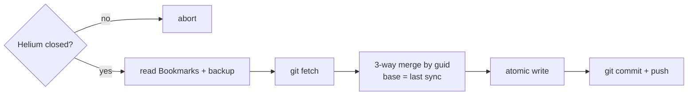

# go-helium-sync

Sync [Helium](https://helium.computer) browser bookmarks between Linux machines, using a private git repo as transport.

Helium (Chromium-based) stores bookmarks in `~/.config/net.imput.helium/Default/Bookmarks` as JSON. This tool reads that file, merges changes by each bookmark's stable `guid`, and writes it back atomically while Helium is closed.



Inspired by [aadarwal/helium-sync](https://github.com/aadarwal/helium-sync) (macOS, Python).

## Install

Download the `.deb`, `.rpm` or tarball from [Releases](https://github.com/etams20/go-helium-sync/releases), e.g.:

```sh
sudo apt install ./hesync_*_linux_amd64.deb
```

or with Go:

```sh
go install github.com/etaMS20/go-helium-sync/cmd/hesync@latest
```

## Usage

Close Helium first, then once per device:

```sh
hesync setup <remote-url>   # first device seeds the repo, later ones merge into it
```

and to sync:

```sh
hesync sync
```

## Releasing

```sh
git tag v0.1.0 && git push origin v0.1.0
```

## Tests

```sh
go test ./...
```
