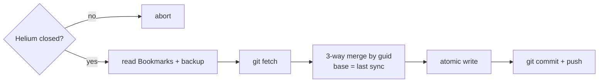

# go-helium-sync

Sync [Helium](https://helium.computer) browser bookmarks between Linux machines, using a private git repo as transport.

Helium (Chromium-based) stores bookmarks in `~/.config/net.imput.helium/Default/Bookmarks` as JSON. This tool reads that file, merges changes by each bookmark's stable `guid`, and writes it back atomically while Helium is closed.



Inspired by [aadarwal/helium-sync](https://github.com/aadarwal/helium-sync) (macOS, Python).

## Install

Download the `.deb`, `.rpm` or tarball from [Releases](https://github.com/etams20/go-helium-sync/releases), e.g.:

```sh
sudo apt install ./hesync_*_linux_amd64.deb
```

or with Go:

```sh
go install github.com/etaMS20/go-helium-sync/cmd/hesync@latest
```

## Usage

Close Helium first, then once per device:

```sh
hesync setup                      # guided: creates/finds a private GitHub repo via gh, or asks for a URL
hesync setup --url <remote-url>   # or use an existing private repo
```

The first device seeds the repo, later ones merge into it.
Without [`gh`](https://cli.github.com), create a private repo yourself (GitHub, GitLab, ...) first.

hesync only reads and writes `bookmarks.json` on the `main` branch. Other files (README, LICENSE, ...)
are left alone, so the repo doesn't have to be empty, but `bookmarks.json` must not already be in use by something else.

and to sync:

```sh
hesync sync
```

`hesync --help` lists all commands, `hesync version` shows the installed version.

## How Bookmarks are synced

Each sync compares three versions of every bookmark and folder, matched by `guid`:

- **base**: the repo as this device left it at its last sync
- **this device**: Helium's bookmarks right now
- **other device**: the repo now, which is still base unless another device synced in between

"Changed" means renamed, new URL, or moved to another folder.
If `base` and `other device` are identical this device's changes are simply pushed.

<details>
<summary><b>Behavior matrix</b></summary>

| This device | Other device             | Result                                              |
| ----------- | ------------------------ | --------------------------------------------------- |
| unchanged   | unchanged                | unchanged                                           |
| added       | –                        | kept                                                |
| –           | added                    | kept                                                |
| changed     | unchanged                | this device's version                               |
| unchanged   | changed                  | other device's version                              |
| changed     | changed, different field | both changes kept (e.g. renamed here + moved there) |
| changed     | changed, same field      | **this device wins**                                |
| deleted     | unchanged                | deleted                                             |
| unchanged   | deleted                  | deleted                                             |
| deleted     | changed                  | kept, with the other device's change                |
| changed     | deleted                  | kept, with this device's change                     |
| deleted     | deleted                  | deleted                                             |

Order inside a folder:

| This device   | Other device | Result               |
| ------------- | ------------ | -------------------- |
| not reordered | any          | other device's order |
| reordered     | any          | this device's order  |

Adding, removing or moving items in or out of a folder doesn't count as reordering.
Items only the losing order knows about are slotted in after the same neighbour they followed there.

Edge cases:

- If an item's folder was deleted on the other device, or two folders were moved into each other on different devices,
  the item is moved to **Other bookmarks** instead of being lost.
- On first `setup` of a device, nothing counts as deleted: bookmarks from both sides are kept.

</details>

## Limitations

- **Helium must be closed** while syncing. Chromium keeps bookmarks in memory and overwrites the file on exit,
  so changes written while it runs would be lost. Syncing a running browser would need an extension using the bookmarks API.
  [Automatic sync](#automatic-sync) works around this by syncing before Helium starts and after it closes.
- **Only the `Default` profile is synced.** Other profiles stay local.

## Automatic sync

[`contrib/hesync-helium`](contrib/hesync-helium) starts Helium, syncing before it opens and after it closes.
To launch Helium through it from the app menu:

```sh
curl -fsSLo ~/.local/bin/hesync-helium https://raw.githubusercontent.com/etams20/go-helium-sync/main/contrib/hesync-helium
chmod +x ~/.local/bin/hesync-helium
sed "s|^Exec=helium %U|Exec=$HOME/.local/bin/hesync-helium %U|" \
  /usr/share/applications/helium.desktop > ~/.local/share/applications/helium.desktop
```

This overrides the system entry. Typing `helium` in a terminal is unaffected.

To undo: `rm ~/.local/share/applications/helium.desktop ~/.local/bin/hesync-helium`.

## Releasing

```sh
git tag v0.1.0 && git push origin v0.1.0
```

## Tests

```sh
go test ./...
```
