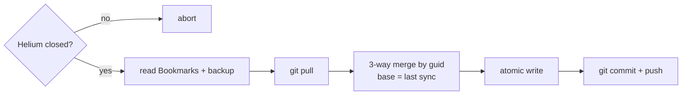

# go-helium-sync

Sync [Helium](https://helium.computer) browser bookmarks between Linux machines, using a private git repo as transport.

Helium (Chromium-based) stores bookmarks in `~/.config/net.imput.helium/Default/Bookmarks` as JSON. This tool reads that file, merges changes by each bookmark's stable `guid`, and writes it back atomically while Helium is closed.



Inspired by [aadarwal/helium-sync](https://github.com/aadarwal/helium-sync) (macOS, Python).

## Usage

Close Helium first, then:

```sh
go run ./src
```

## Tests

```sh
go test ./src
```
